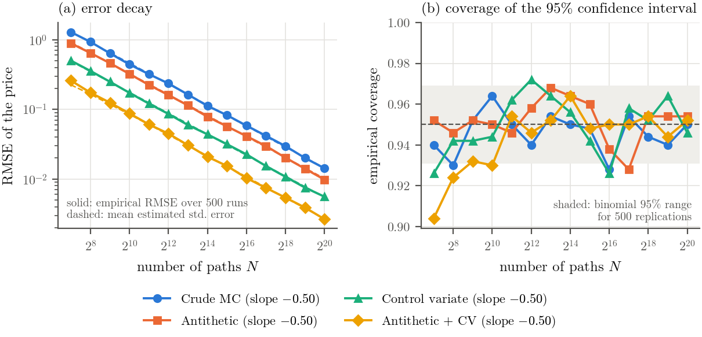
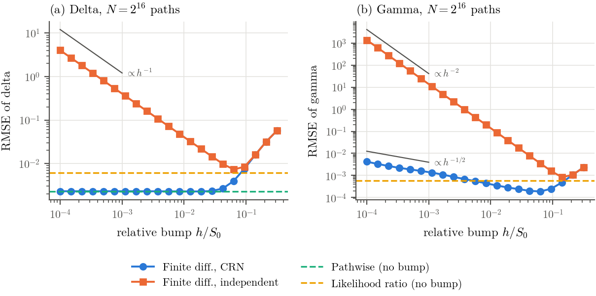

# Monte Carlo Option Pricer

[](https://github.com/KvnFltr/monte-carlo-option-pricer/actions/workflows/ci.yml)
[](LICENSE)


A C++20 Monte Carlo pricer for European options, benchmarked against the Black-Scholes closed form.
Because the exact price and Greeks are known, the error of every estimator can be measured rather than
guessed. The project studies:

- the **$1/\sqrt{N}$ convergence** of Monte Carlo and the reliability of its confidence intervals;
- **variance reduction**: antithetic variates, a control variate on the terminal price, and both combined;
- **Greeks by finite differences**, with and without common random numbers, against pathwise and
  likelihood-ratio estimators;
- two extensions: an **arithmetic Asian option** with the geometric (Kemna-Vorst) control variate, and
  **randomised quasi-Monte Carlo**.

The accompanying 13-page report, [`report/report.pdf`](report/report.pdf), derives the estimators and their
variances and discusses every result. All of its numbers, tables and figures are generated by the code in
this repository.

## Results at a glance

At-the-money call, $S_0 = K = 100$, $r = 5\%$, $\sigma = 20\%$, $T = 1$, Black-Scholes price **10.4506**,
$N = 2^{22}$ paths per estimator:

| Estimator                    | Price ± std. error | Variance reduction | Efficiency gain* |
|------------------------------|--------------------|-------------------:|-----------------:|
| Crude Monte Carlo            | 10.4484 ± 0.0072   |               1.00 |             1.00 |
| Antithetic variates          | 10.4574 ± 0.0051   |               2.00 |             3.69 |
| Control variate ($e^{-rT}S_T$) | 10.4539 ± 0.0027 |               6.89 |             6.30 |
| Antithetic + control variate | 10.4510 ± 0.0013   |               28.7 |             53.5 |

\* variance × computing time of crude MC divided by that of the estimator: the speed-up for a given accuracy.

- Over 500 independent replications the RMSE decays as $N^{-0.496}$ (crude) and the estimated standard
  error matches the true RMSE within 4%.
- Common random numbers divide the variance of the finite-difference Delta by 332 and of Gamma by ~10⁵.
- The geometric control variate cuts the variance of an arithmetic Asian option by a factor of 1,301.
- Randomised QMC converges as $N^{-0.93}$: at $N = 2^{20}$ its error is 271 times smaller than crude MC.
- 125 million paths per second on 16 threads (i7-1260P), with results **bitwise identical for any number
  of threads**.





More figures: [variance reduction vs strike](docs/img/variance_reduction.png),
[running estimate](docs/img/running_estimate.png), [quasi-Monte Carlo](docs/img/qmc.png).

## Design

- **Counter-based RNG.** Random numbers come from Philox4x32-10 (Salmon et al., 2011), validated against the
  Random123 known-answer vectors. Path `i` reads the stream `(seed, i)`, so it gets the same draws whichever
  thread simulates it. This gives reproducibility independent of the thread count, nested runs (the run with
  N paths is a prefix of every longer run) and common random numbers by construction.
- **Exact inverse normal.** Gaussians are obtained by inversion with Wichura's AS 241 algorithm (about 1e-16
  relative accuracy), one uniform per draw, which also lets quasi-random points be used unchanged.
- **Deterministic parallel reduction.** Paths are processed in fixed blocks with OpenMP (dynamic schedule);
  each block keeps Welford running moments, merged in a fixed order with the Chan-Golub-LeVeque formulas.
- **Exact simulation.** $S_T$ is sampled from its lognormal law, so there is no discretisation bias and the
  only error is statistical.
- **Tests.** 119 GoogleTest cases: known-answer vectors, reference prices, put-call parity, closed-form Greeks
  vs finite differences, statistical tests of every estimator at 4 standard errors (deterministic, never
  flaky), CI coverage, and bitwise reproducibility across thread counts. CI runs on Linux, macOS and Windows,
  plus an AddressSanitizer/UBSan build.

## Build and run

Requirements: a C++20 compiler (GCC 11+, Clang 14+, MSVC 2022), CMake 3.20+. OpenMP is optional.
GoogleTest is downloaded automatically when tests are enabled.

```bash
cmake -S . -B build -DCMAKE_BUILD_TYPE=Release
cmake --build build --config Release --parallel
ctest --test-dir build -C Release --output-on-failure
```

Price an option from the command line (on Windows with Visual Studio the binaries are in `build/Release/`):

```text
$ ./build/mc_pricer --type call --strike 100 --paths 1000000 --greeks
European call  S0=100  K=100  r=0.05  q=0  sigma=0.2  T=1
Black-Scholes price        10.450584

Monte Carlo: 1000000 paths, seed 42, 16 thread(s)
method                            price    std.err                  95% CI  z-score      VRF  time [ms]
crude                          10.45369    0.01471   [ 10.42486,  10.48252]     0.21      1.0       ...
antithetic                     10.43035    0.01038   [ 10.41001,  10.45069]    -1.95      2.0       ...
control_variate                10.43939    0.00560   [ 10.42841,  10.45036]    -2.00      6.9       ...
antithetic_control_variate     10.44980    0.00275   [ 10.44441,  10.45519]    -0.28     28.6       ...

Greeks (value +/- standard error)
greek      analytic       finite diff. (CRN)                 pathwise         likelihood ratio
delta      0.636831      0.63735 +/- 0.00057      0.63744 +/- 0.00058      0.63645 +/- 0.00146
gamma      0.018762      0.01872 +/- 0.00011                      n/a      0.01868 +/- 0.00014
vega      37.524035     37.51378 +/- 0.07563     37.51419 +/- 0.07563     37.36140 +/- 0.27385
rho       53.232482     53.29064 +/- 0.04721     53.29006 +/- 0.04722     53.19099 +/- 0.13302
theta     -6.414028     -6.41593 +/- 0.00886     -6.41592 +/- 0.00886                      n/a
```

Options: `--type call|put`, `--spot`, `--strike`, `--rate`, `--div`, `--vol`, `--maturity`, `--paths`,
`--seed`, `--threads`, `--greeks`.

## Reproducing the report

```bash
./build/run_experiments results          # all experiments, about 5 minutes on 16 threads
pip install -r scripts/requirements.txt
python scripts/make_figures.py           # figures, LaTeX tables and macros
latexmk -pdf -cd report/report.tex
```

The experiments are deterministic: the statistical results are reproduced exactly, only timings depend on the
machine. `run_experiments --quick` runs a reduced version in a few seconds.

## Repository layout

```text
include/mcpricer/   public headers
  black_scholes.hpp   closed-form price and Greeks
  european.hpp        Monte Carlo engine: crude, antithetic, control variate, combined
  greeks.hpp          finite differences (CRN / independent), pathwise, likelihood ratio
  asian.hpp           arithmetic and geometric Asian options, geometric closed form
  qmc.hpp             van der Corput sequence and randomised QMC
  rng.hpp             Philox4x32-10 and random streams
  normal.hpp          normal pdf, cdf and inverse cdf (AS 241)
  statistics.hpp      Welford accumulators with exact merge
  parallel.hpp        deterministic OpenMP reduction
src/                implementation
apps/               mc_pricer (CLI) and run_experiments (writes results/*.csv)
tests/              GoogleTest suite
scripts/            make_figures.py (figures and LaTeX tables from the CSV files)
results/            raw experiment output
report/             LaTeX source and compiled report
```

## Library example

```cpp
#include <mcpricer/mcpricer.hpp>

mcp::Market market{100.0, 0.05, 0.0, 0.2};            // spot, rate, dividend yield, vol
mcp::EuropeanOption call{mcp::OptionType::Call, 100.0, 1.0};

auto mc = mcp::price_european_mc(call, market,
    {1u << 20, /*seed=*/42, mcp::VarianceReduction::AntitheticControlVariate});
double exact = mcp::bs_price(call, market);
// mc.price, mc.std_error, mc.ci_lower, mc.ci_upper, mc.cv_beta, ...

auto delta = mcp::mc_greek(mcp::Greek::Delta, mcp::GreekMethod::FiniteDifferenceCRN, call, market,
                           {1u << 20, 42, /*bump=*/1.0});
```

## References

- F. Black, M. Scholes, *The Pricing of Options and Corporate Liabilities*, JPE, 1973.
- P. Glasserman, *Monte Carlo Methods in Financial Engineering*, Springer, 2003.
- M. Broadie, P. Glasserman, *Estimating Security Price Derivatives Using Simulation*, Management Science, 1996.
- A. Kemna, A. Vorst, *A Pricing Method for Options Based on Average Asset Values*, J. Banking & Finance, 1990.
- J. Salmon et al., *Parallel Random Numbers: As Easy as 1, 2, 3*, SC'11, 2011.
- M. Wichura, *Algorithm AS 241: The Percentage Points of the Normal Distribution*, Applied Statistics, 1988.

The full bibliography is in the report.

## License

MIT, see [LICENSE](LICENSE).
